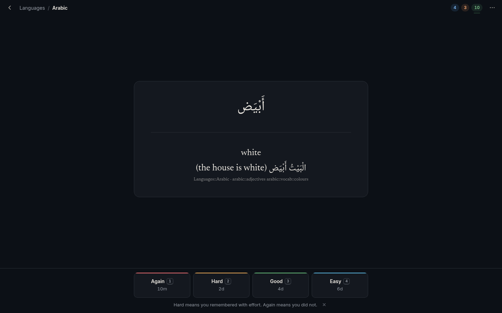
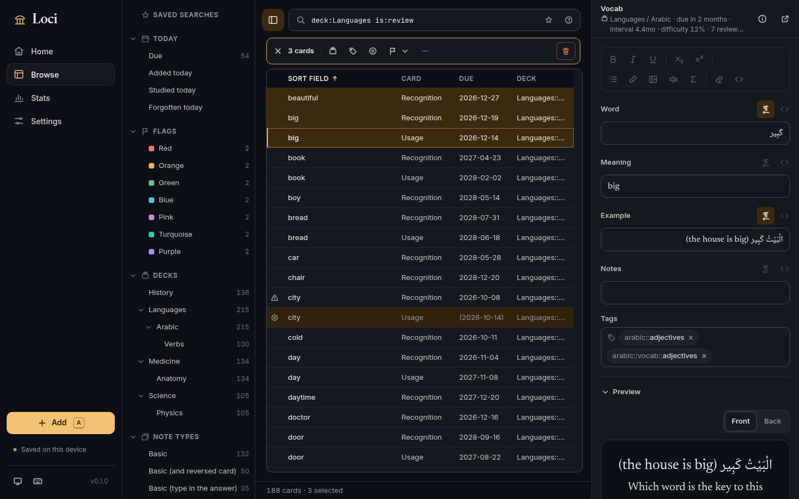
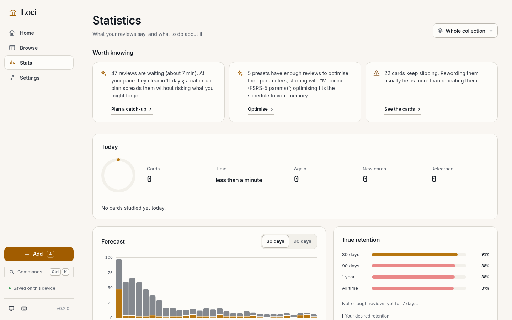

<p align="center"></p>

# Loci

Loci is a spaced-repetition app for Linux, Windows, macOS, Android and the browser. It is for
people who already study with Anki, or want to: it imports an Anki collection with its review
history and scheduling state, schedules it with FSRS-6 (or SM-2), and exports back to `.apkg`.
The collection is a SQLite file on your own device; there is no account and no server.

<https://zahakj.github.io/loci-rs/>

<p align="center">
  
  
</p>
<p align="center">
  
  
</p>

## Features

- **Anki import and export.** Reads `.apkg` and `.colpkg` in all three package layouts, with notes, note types, templates, media, tags, decks, review history and FSRS state; a card due tomorrow in Anki is due tomorrow here. Exports `.apkg` that Anki 2.1 through 26.x and AnkiDroid import.
- **FSRS-6 scheduling.** A port of the reference scheduler, checked against its published test vectors. *Optimise* fits the 21 parameters to your own reviews, per preset; SM-2 is selectable per preset.
- **Workload you can see.** A daily time budget instead of card caps, a catch-up view that spreads a backlog over several days, and a 90-day forecast of reviews before you change new cards per day or desired retention.
- **A study screen for keyboard and thumb.** Space shows the answer, `1`–`4` grade, `z` undoes, `i` explains why a card got its interval. On phones the grade buttons sit at the bottom in fixed positions.
- **Cards as Anki writes them.** Basic, reversed, typed answers with a character diff, nested cloze, image occlusion, KaTeX maths, audio, and Arabic and other right-to-left text.
- **Browse with Anki search syntax.** Search, sort and bulk-edit cards or notes: change deck, add or remove tags, suspend, set a due date, find and replace. Every bulk action can be undone.
- **Statistics with a sentence each.** Forecast, true retention against your target, intervals, difficulty, hourly performance; an insights strip suggests one action when there is one.
- **Sync without an account.** Point each device at a folder that Syncthing, Dropbox or Drive keeps in step, or carry a sync file across. Reviews from every device are kept.
- **Backups.** Rotating automatic backups (12 daily, 10 weekly, 9 monthly), an integrity check on open, restore from any backup, and a full-backup zip with collection and media.

## Install

In the browser: <https://zahakj.github.io/loci-rs/app/> (installs as an app and works
offline). Every other build is on the
[latest release](https://github.com/ZahakJ/loci-rs/releases/latest).

Linux (AppImage; `.deb` and `.rpm` on the release page):

```sh
curl -LO https://github.com/ZahakJ/loci-rs/releases/download/v0.2.1/Loci_0.2.1_amd64.AppImage
chmod +x Loci_0.2.1_amd64.AppImage && ./Loci_0.2.1_amd64.AppImage
```

Windows (PowerShell; or the `-setup.exe`):

```powershell
Invoke-WebRequest https://github.com/ZahakJ/loci-rs/releases/download/v0.2.1/Loci_0.2.1_x64_en-US.msi -OutFile Loci.msi; Start-Process .\Loci.msi
```

macOS (Apple silicon; for Intel replace `aarch64` with `x64`):

```sh
curl -LO https://github.com/ZahakJ/loci-rs/releases/download/v0.2.1/Loci_0.2.1_aarch64.dmg && open Loci_0.2.1_aarch64.dmg
```

The macOS build is not notarised: on first launch right-click → Open, or run
`xattr -cr /Applications/Loci.app` ([details](docs/macos-gatekeeper.md)).

Android 7.0+ (arm64; a universal APK is on the release page):

```sh
curl -LO https://github.com/ZahakJ/loci-rs/releases/download/v0.2.1/loci-v0.2.1-android-arm64.apk && adb install loci-v0.2.1-android-arm64.apk
```

From source (Rust as pinned in `rust-toolchain.toml`, Node, pnpm; on Linux the WebKitGTK
libraries Tauri needs):

```sh
git clone https://github.com/ZahakJ/loci-rs && cd loci-rs/apps/loci
pnpm install && pnpm tauri build
```

## First run

An empty collection opens on three choices: *Import from Anki* (drop an `.apkg` or `.colpkg`;
Loci shows a preview of notes, cards, reviews and media before writing anything), *Try a sample
deck* (thirty cards with cloze, image, maths and Arabic), or *Start empty*. Choose a deck on
Home and press Start. `a` adds a note from anywhere, `?` lists every key, and Ctrl/Cmd+K opens
the command palette.

The `loci` CLI works on a collection directory without the app:

```sh
cargo run -p loci-cli -- import deck.apkg --dir ~/loci-test
cargo run -p loci-cli -- due --dir ~/loci-test
cargo run -p loci-cli -- stats --dir ~/loci-test
```

## How it works

The engine, `crates/loci-core`, is a Rust library that owns everything: the SQLite schema,
both schedulers, Anki package reading and writing, the search parser, statistics, backups and
sync. Its tables use Anki's column names and units, so import is a mapping rather than a
translation, and FSRS memory state stays in `cards.data` where Anki keeps it, which lets a
collection round-trip through Anki without losing either scheduler's state. The interface is
React inside Tauri (Anki cards are HTML, so a webview renders them as Anki does) and reaches the
engine through a single `rpc` command. The same JSON protocol runs over local HTTP in
`loci serve` for development and the Playwright tests, and in a web worker for the browser
build, where `crates/loci-web` compiles the engine to WebAssembly and keeps the database in
OPFS. Sync writes one file per device into the shared folder; each device merges the others'
files row by row, ordered by hybrid-logical-clock stamps, so no server has to arbitrate.

```
crates/loci-core   engine: SQLite, FSRS-6 and SM-2, Anki import/export, search, stats, backups, sync
crates/loci-cli    loci: import, export, due, study, stats, backup, integrity, serve
crates/loci-web    engine as WebAssembly for the browser build
apps/loci          Tauri 2 app (React UI) for desktop and Android; also the browser build
```

## Documentation

- The [manual](https://zahakj.github.io/loci-rs/manual/) ([source](docs/manual/src/)):
  [getting started](docs/manual/src/getting-started.md),
  [import, export and backups](docs/manual/src/import-export-backups.md),
  [FSRS-6](docs/manual/src/fsrs.md), [the CLI](docs/manual/src/cli.md),
  [architecture](docs/manual/src/architecture.md),
  [performance](docs/manual/src/performance.md).
- [Search syntax](docs/SEARCH.md), [sync](docs/SYNC.md), [data safety](docs/DATA-SAFETY.md).
- [Internals](docs/internals.md): intended behaviour and the numbers behind it.

## Development

```sh
cargo test --workspace            # engine
./verify --quick                  # fmt, clippy, tests, frontend typecheck and vitest
./verify                          # plus Tauri build and Playwright
cd apps/loci && pnpm tauri dev    # app with hot reload
cd apps/loci && pnpm build:wasm && pnpm build:web   # browser build
```

See [CONTRIBUTING.md](CONTRIBUTING.md) to send a change and [SECURITY.md](SECURITY.md) to
report a vulnerability.

## License

MIT
