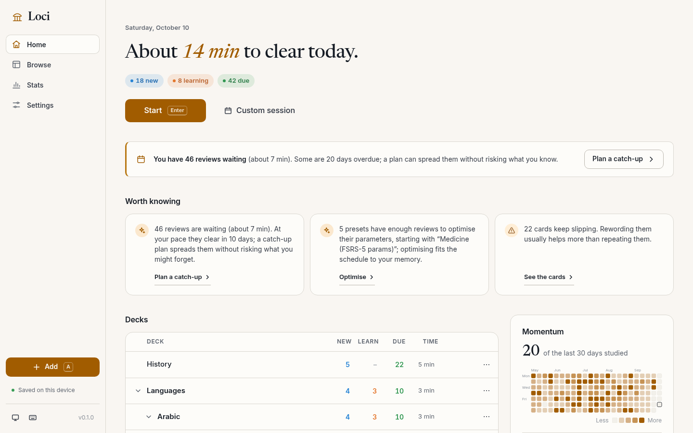
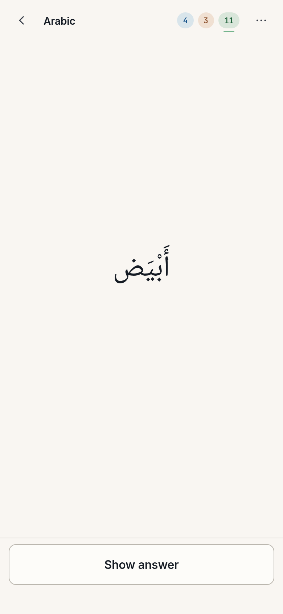
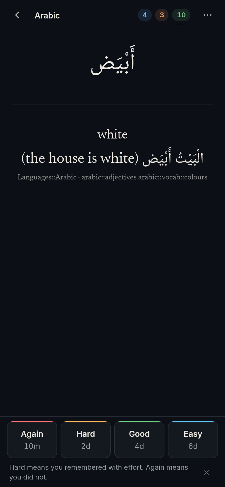
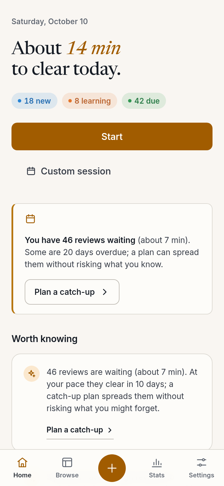
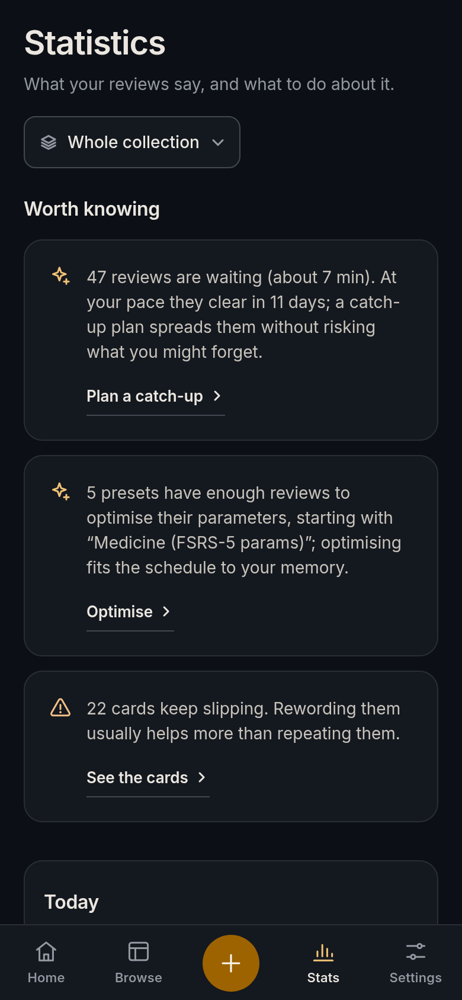

<p align="center"></p>
<h1 align="center">Loci</h1>

Loci is a local-first spaced-repetition app, written in Rust, that imports your Anki collection with its history intact, schedules it with FSRS-6, and runs on Linux, Windows, macOS and Android.

## Install

Download one file for your platform from the [latest release](https://github.com/ZahakJ/loci-rs/releases/latest), or paste the matching line.

**Linux** (AppImage; `.deb` and `.rpm` are on the release page too)

```sh
curl -LO https://github.com/ZahakJ/loci-rs/releases/download/v0.1.0/Loci_0.1.0_amd64.AppImage && chmod +x Loci_0.1.0_amd64.AppImage && ./Loci_0.1.0_amd64.AppImage
```

**Windows** (PowerShell; `.msi` installer, or the `-setup.exe`)

```powershell
Invoke-WebRequest https://github.com/ZahakJ/loci-rs/releases/download/v0.1.0/Loci_0.1.0_x64_en-US.msi -OutFile Loci.msi; Start-Process .\Loci.msi
```

**macOS** (Apple silicon; Intel: replace `aarch64` with `x64`)

```sh
curl -LO https://github.com/ZahakJ/loci-rs/releases/download/v0.1.0/Loci_0.1.0_aarch64.dmg && open Loci_0.1.0_aarch64.dmg
```

The macOS build is not notarised: after dragging Loci to Applications, run `xattr -d com.apple.quarantine /Applications/Loci.app` once, or right-click → Open.

**Android** (arm64 phones; a universal APK for every ABI is on the release page)

```sh
curl -LO https://github.com/ZahakJ/loci-rs/releases/download/v0.1.0/loci-v0.1.0-android-arm64.apk && adb install loci-v0.1.0-android-arm64.apk
```

Or open the APK link on the phone and allow installs from your browser. Android 7.0 (API 24) or newer.

**From source**

```sh
git clone git@github.com:ZahakJ/loci-rs.git && cd loci-rs/apps/loci && pnpm install && pnpm tauri build
```

## Screenshots

<p align="center"></p>
<p align="center">
  
  
  
  
</p>

The captures show the synthetic fixture collection (`fixtures/`, 402 notes, 590 cards, three years of simulated history) imported into the Rust engine and rendered by the app's own interface; no real deck was used. Every screen, in both themes and at desktop and phone size, is in `docs/captures/` and on the [project page](https://zahakj.github.io/loci-rs/).

## What it is

- **A real Anki replacement.** Imports `.apkg` and `.colpkg` from every Anki version (legacy and current package layouts) with notes, note types, templates, media, tags, decks, review history and scheduling state. A card due tomorrow in Anki is due tomorrow here. Exports back to `.apkg` that Anki 2.1 through 26.x and AnkiDroid read.
- **FSRS-6 by default**, ported from the reference implementation and tested against its published vectors. *Optimise*, a button in each preset's settings, fits the parameters to your own reviews. The engine also implements automatic optimisation (after 400 new reviews per preset), but the v0.1.0 interface does not call it yet. Anki's SM-2 is there for people who want it.
- **One app for desktop, laptop and phone.** Native builds for Linux, Windows, macOS and Android from one Rust engine and one interface; a study screen designed around the keyboard on a desk and the thumb on a phone; light and dark themes that are designed rather than inverted; typography that renders Arabic, mathematics and code well.
- **Humane about workload.** A catch-up mode for backlogs, a daily time budget instead of card caps, a workload forecast before you change settings, and momentum instead of streaks.
- **Data you own.** A real SQLite file in your app-data folder, rotating automatic backups (written when the window closes or the app is hidden; the engine's 30-minute backup is not yet called by the interface), restore, an integrity check on open, and a full-backup zip (collection plus media) that Loci restores. No account, no server, nothing leaves the device.

Loci started as a TypeScript web app (ZahakJ/loci). This repository is the Rust rewrite; the TypeScript app's full-backup zip imports here unchanged, so nothing is lost moving over.

On the development desktop, a release build starts cold in 806–827 ms, imports a 100,000-card `.apkg` in 4.6 s, loads a Browse page in 86–91 ms at any offset, and answers a card in 0.4 ms engine-side; the method and the full table are in the manual's [performance record](https://zahakj.github.io/loci-rs/manual/performance.html).

## Architecture

```
crates/loci-core    the engine: SQLite (rusqlite, FTS5), FSRS-6 and SM-2, Anki package import/export,
                    the Loci full-backup format, Anki search syntax, browser queries, statistics,
                    catch-up, rotating backups, integrity check. A pure library with its own tests.
crates/loci-cli     `loci`: import, export, due, study, stats, backup, integrity, and `serve`
                    (the engine over local HTTP for development and the end-to-end tests).
apps/loci           the Tauri 2 app for Linux, Windows, macOS and Android: React UI calling the
                    engine through Tauri `invoke`.
```

Why the interface stays web technology, where the data lives, and the decisions worth knowing (FSRS ported by hand, the export layout, filtered decks, deferred sync and iOS) are in the manual's [architecture chapter](https://zahakj.github.io/loci-rs/manual/architecture.html), [getting started](https://zahakj.github.io/loci-rs/manual/getting-started.html), `DESIGN.md` (§4 and §20) and `docs/DEFERRED.md`.

## Documents

- The [project page](https://zahakj.github.io/loci-rs/): downloads and screenshots.
- The [manual](https://zahakj.github.io/loci-rs/manual/): getting started; the data model and Anki compatibility; FSRS-6 from first principles; import, export and backups; search syntax; the CLI; architecture for contributors; the performance record; the changelog; the roadmap.
- `DESIGN.md` (the design contract), `PLAN.md` (how the port was done), `docs/DATA-SAFETY.md`, `docs/SEARCH.md`, `docs/SYNC.md`, `docs/DEFERRED.md`, and `research/` (Anki format, FSRS spec, the complaints C1–C29 this app answers).

## Development

```sh
./verify            # the release gate: fmt, clippy, cargo test, frontend typecheck + vitest, Tauri build, e2e
./verify --quick    # fmt, clippy, cargo test, frontend typecheck + vitest
cd apps/loci && pnpm tauri dev   # desktop app with hot reload
```

Tests are `cargo test --workspace` for the engine, vitest for the UI helpers and Playwright against `loci serve`, all on synthetic fixture decks; the CLI is in the manual, and `pnpm tauri android build --apk` in `apps/loci` builds the APK (needs `ANDROID_HOME`, `NDK_HOME`, `JAVA_HOME`). CI runs `verify` on every push, and tags `v*` build and attach the Linux, Windows, macOS and Android packages to a GitHub release.

## Licence

MIT. See [CONTRIBUTING.md](CONTRIBUTING.md) to send a change and [SECURITY.md](SECURITY.md) to report a vulnerability.
