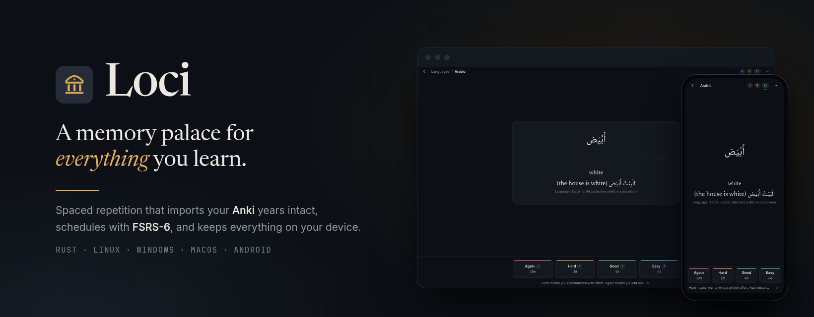

<p align="center"></p>

# Loci

Spaced-repetition app for Linux, Windows, macOS, Android and the browser. Imports Anki
collections with their review history, schedules with FSRS-6 or SM-2, and
exports back to `.apkg`. Rust engine, Tauri shell.

<https://zahakj.github.io/loci-rs/>


## Install

In the browser: <https://zahakj.github.io/loci-rs/app/> (installs as an app, works
offline). Every other build is on the
[latest release](https://github.com/ZahakJ/loci-rs/releases/latest).

Linux (AppImage; `.deb` and `.rpm` on the release page):

```sh
curl -LO https://github.com/ZahakJ/loci-rs/releases/download/v0.2.1/Loci_0.2.1_amd64.AppImage
chmod +x Loci_0.2.1_amd64.AppImage && ./Loci_0.2.1_amd64.AppImage
```

Windows (PowerShell; or the `-setup.exe`):

```powershell
Invoke-WebRequest https://github.com/ZahakJ/loci-rs/releases/download/v0.2.1/Loci_0.2.1_x64_en-US.msi -OutFile Loci.msi; Start-Process .\Loci.msi
```

macOS (Apple silicon; for Intel replace `aarch64` with `x64`):

```sh
curl -LO https://github.com/ZahakJ/loci-rs/releases/download/v0.2.1/Loci_0.2.1_aarch64.dmg && open Loci_0.2.1_aarch64.dmg
```

The macOS build is not notarised: on first launch right-click → Open, or run
`xattr -cr /Applications/Loci.app` ([details](docs/macos-gatekeeper.md)).

Android 7.0+ (arm64; a universal APK is on the release page):

```sh
curl -LO https://github.com/ZahakJ/loci-rs/releases/download/v0.2.1/loci-v0.2.1-android-arm64.apk && adb install loci-v0.2.1-android-arm64.apk
```

From source (Rust, Node, pnpm):

```sh
git clone https://github.com/ZahakJ/loci-rs && cd loci-rs/apps/loci
pnpm install && pnpm tauri build
```

## Usage

Import an `.apkg` or `.colpkg` from Anki, or start with the sample deck. In the
study screen space shows the answer, `1`–`4` grade, `z` undoes, `i` explains
the interval and `?` lists every key. Ctrl/Cmd+K opens the command palette.

The collection is a SQLite file in the platform's app-data directory, with
rotating backups beside it. Devices sync through a shared folder (Syncthing,
Dropbox, Drive) or a sync file carried across; no account, no server
([sync](docs/SYNC.md)). The `loci` CLI works on a collection directory:

```sh
cargo run -p loci-cli -- import deck.apkg --dir ~/loci-test
cargo run -p loci-cli -- due --dir ~/loci-test
```

The [manual](https://zahakj.github.io/loci-rs/manual/) covers import, backups,
search syntax, sync, FSRS and the CLI.

## Layout

```
crates/loci-core   engine: SQLite, FSRS-6 and SM-2, Anki import/export, search, stats, backups
crates/loci-cli    loci: import, export, due, study, stats, backup, integrity, serve
crates/loci-web    engine as WebAssembly for the browser build
apps/loci          Tauri 2 app (React UI) for desktop and Android; also the browser build
```

Internals: [docs/internals.md](docs/internals.md).

## Development

```sh
cargo test --workspace            # engine
./verify --quick                  # fmt, clippy, tests, frontend typecheck and vitest
./verify                          # plus Tauri build and Playwright
cd apps/loci && pnpm tauri dev    # app with hot reload
cd apps/loci && pnpm build:wasm && pnpm build:web   # browser build
```

## License

MIT
